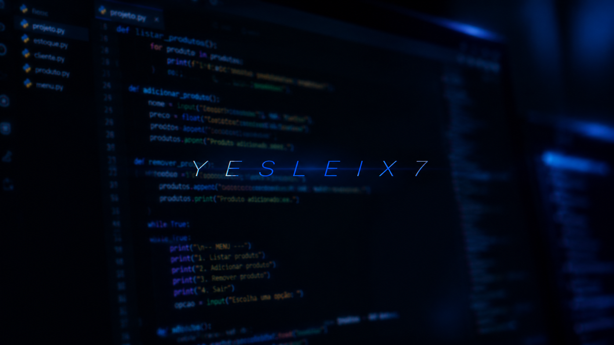

  

<h1 align="center">Olá, eu sou Yeslei 👋</h1>

  <em>Desenvolvedor em formação | Python • SQL • SQLite</em>

  Estudando programação orientada a objetos e desenvolvendo projetos práticos para evoluir como desenvolvedor de software.

---

## Sobre mim

- Estudando Python e programação orientada a objetos
- Desenvolvendo um sistema de controle de estoque
- Praticando persistência de dados com SQLite
- Aprendendo continuamente sobre desenvolvimento de software

## Tecnologias

  
  
  
  

## Projetos

### Sistema de Controle de Estoque
Sistema desenvolvido em Python com funcionalidades
de cadastro e gerenciamento de produtos e integração
com SQLite.

### Estudos de Python
Exercícios e projetos desenvolvidos durante
meu aprendizado de programação.

---

  <i>Construindo conhecimento . . ..</i>

